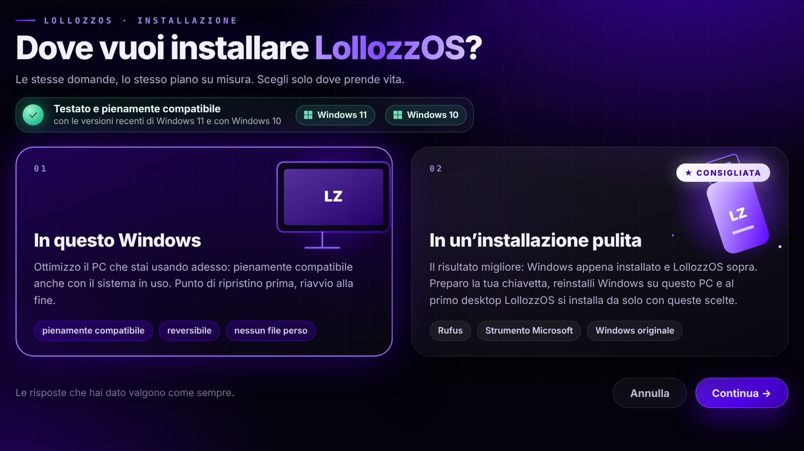
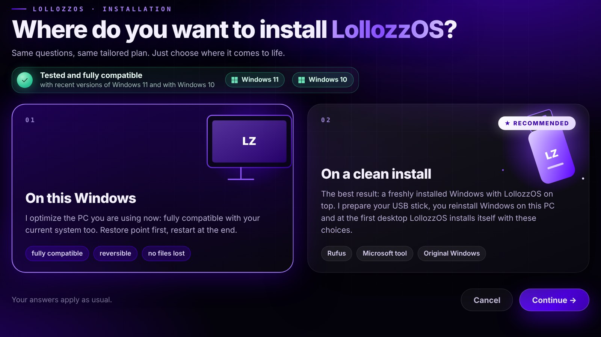

  

  
  
  

  
  
  
  

<h3 align="center">Il tuo PC, pronto per giocare.</h3>

Un click. Windows più leggero, più reattivo, tutto per il gioco. <a href="#english">English below</a>

<table>
<tr>
<td width="33%" valign="top"><b>Un click. Tutto il PC.</b> Poche domande, poi LollozzOS fa tutto da solo, su misura per il tuo hardware.</td>
<td width="33%" valign="top"><b>Si accende con il gioco.</b> La Modalità competitiva parte con la partita e si spegne quando la chiudi.</td>
<td width="33%" valign="top"><b>Tutto si annulla.</b> Ogni modifica salva il prima. Un interruttore, e torna com'era.</td>
</tr>
</table>

## Novità della versione 5.0

- **Timer su misura** · misura il tuo PC e sceglie il timer più preciso per lui.
- **Processore libero** · mitigazioni complete: più FPS nei giochi che spingono la CPU.
- **Prestazioni avanzate** · dispositivi in background spenti, solo se il tuo PC li ha.
- **Driver vecchi, via da soli** · versioni superate eliminate in automatico, niente conflitti.
- **Mouse e rete più reattivi** · mouse pieno anche in background, rete sul core giusto.
- **Strumenti dal desktop** · libera la RAM, riavvia l'audio, ripara Windows e console da amministratore dal tasto destro.

## Inizia

1. Scarica `LollozzOS_Setup` da [Releases](https://github.com/LollozzOS/LollozzOs/releases/latest) e avvialo.
2. Provalo gratis per 24 ore: parti da **Installa LollozzOS** nella Home.
3. Per la licenza scrivi sul [Discord](https://discord.gg/gd5cT3Jw9M): una licenza, tutta l'app, su un computer.

**Testato e pienamente compatibile** con le versioni recenti di Windows 11 e con Windows 10, 64 bit. Il risultato migliore è su un Windows appena installato, ma è pienamente compatibile anche con il sistema che usi già.

> L'installazione non è firmata: se Windows SmartScreen avvisa, scegli **Ulteriori informazioni** e poi **Esegui comunque**. Scaricalo solo da qui o dal sito.

## Crediti

Alcune funzioni usano strumenti di altri autori, con il loro permesso e la loro licenza MIT accanto: [WinUtil](https://github.com/ChrisTitusTech/winutil) di Chris Titus Tech, [Win11Debloat](https://github.com/Raphire/Win11Debloat) di Raphire, [RemoveWindowsAI](https://github.com/zoicware/RemoveWindowsAI) di zoicware, [Open-Shell](https://github.com/Open-Shell/Open-Shell-Menu), NVIDIA Profile Inspector di Orbmu2k, [PresentMon](https://github.com/GameTechDev/PresentMon) di Intel, TCP Optimizer di SpeedGuide.

  <a href="https://discord.gg/gd5cT3Jw9M">Discord</a> ·
  <a href="https://www.instagram.com/_lollozz__">Instagram</a> ·
  <a href="https://www.tiktok.com/@_lollozz_">TikTok</a> ·
  <a href="https://www.twitch.tv/lollozz__">Twitch</a> ·
  <a href="https://ko-fi.com/lollozzos">Ko-fi</a>

---

<h3 align="center">Your PC, ready to play.</h3>

One click. A lighter, more responsive Windows, all for gaming.

<table>
<tr>
<td width="33%" valign="top"><b>One click. The whole PC.</b> A few questions, then LollozzOS does it all by itself, tailored to your hardware.</td>
<td width="33%" valign="top"><b>Turns on with the game.</b> Competitive mode starts with the match and stops when you close it.</td>
<td width="33%" valign="top"><b>Everything undoes.</b> Every change saves the before. One toggle, and it's back as it was.</td>
</tr>
</table>

### What's new in version 5.0

- **Custom timer** · measures your PC and picks the most precise timer for it.
- **Free processor** · complete mitigations: more FPS in CPU-heavy games.
- **Advanced performance** · background devices turned off, only if your PC has them.
- **Old drivers, gone by themselves** · outdated versions removed automatically, no conflicts.
- **More responsive mouse and network** · full mouse response in background, network on the right core.
- **Tools from the desktop** · free up RAM, restart audio, repair Windows and admin consoles from right-click.

### Get started

Download `LollozzOS_Setup` from [Releases](https://github.com/LollozzOS/LollozzOs/releases/latest), try it free for 24 hours starting from **Install LollozzOS** on the Home, and get your license on [Discord](https://discord.gg/gd5cT3Jw9M): one license, the whole app, on one computer.

**Tested and fully compatible** with recent versions of Windows 11 and with Windows 10, 64-bit. Best on a freshly installed Windows, fully compatible with the system you already use too. The installer is not signed: if SmartScreen warns you, choose **More info** and then **Run anyway**.

---

Software provided as is, without warranty. LollozzOS is not affiliated with Microsoft or with game publishers; trademarks belong to their owners. © 2026 Lollozz.

 <b>LollozzOS</b> · creato da Lollozz

