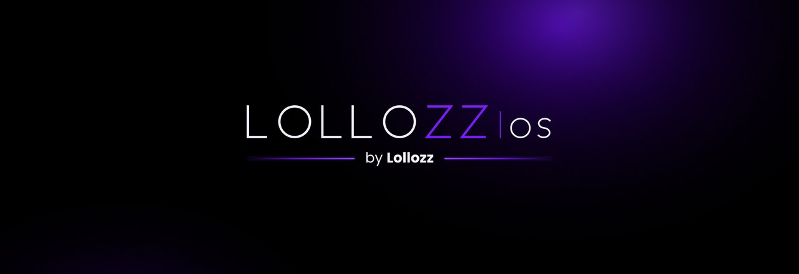
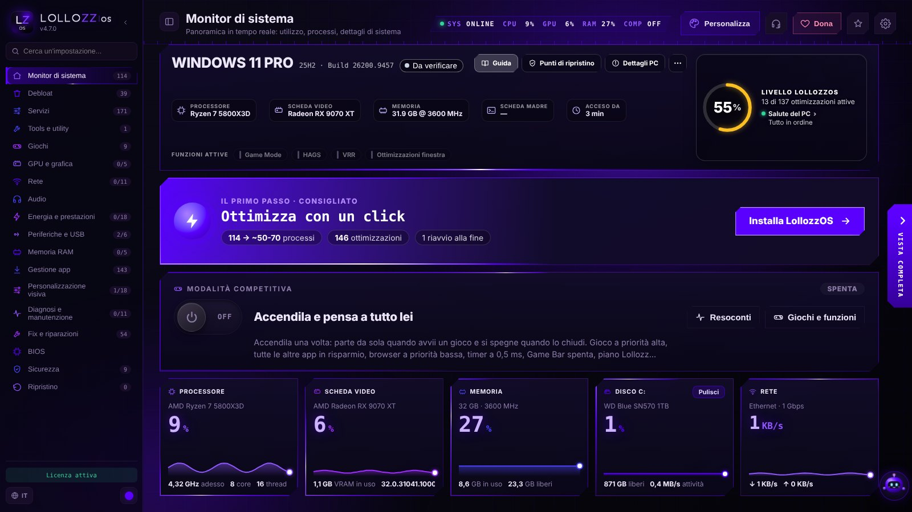
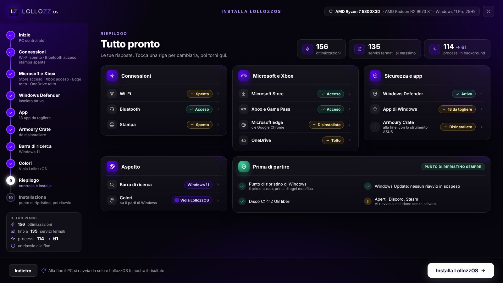
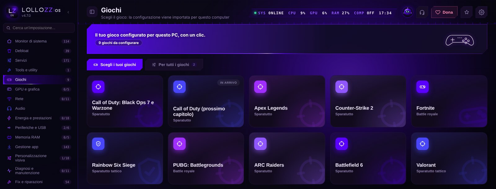
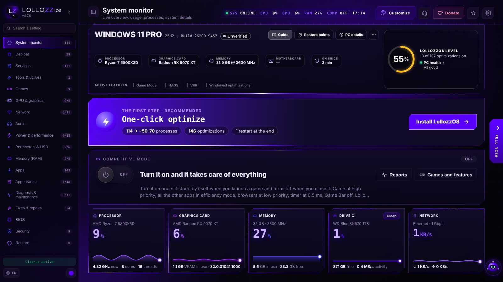
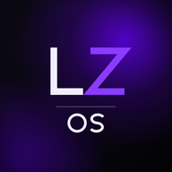

  

  <b>Il tuo PC, pronto per giocare.</b> 
  Ottimizzazione di Windows 10 e 11 per il gaming, in un’app sola. Ogni modifica si annulla.

  <a href="https://github.com/LollozzOS/LollozzOs/releases/latest"><b>Scarica</b></a> ·
  <a href="https://lollozzos.github.io/LollozzOs/"><b>Sito</b></a> ·
  <a href="#novita"><b>Novità</b></a> ·
  <a href="https://discord.gg/gd5cT3Jw9M"><b>Discord</b></a> ·
  <a href="#english">English</a>

  

## Novità

*Aggiornato al 14 ottobre 2026.* L’app controlla da sola gli aggiornamenti: quando esce una versione nuova te lo dice, la scarica e apre l’installazione. Licenza, impostazioni e backup restano.

- **Installa LollozzOS, un percorso solo.** Rispondi a poche domande e le ottimizzazioni partono tutte insieme, con il punto di ripristino come primo passo.
- **Quello che usi resta acceso.** Wi-Fi collegato, Bluetooth con dispositivi associati e stampanti installate non si spengono. Se tieni Xbox, lo Store continua ad aggiornare i giochi di Game Pass.
- **Si spengono solo i driver inutili.** LollozzOS guarda i dispositivi del tuo PC e lascia attivo ogni driver che usano, compresi quelli dei dischi.
- **Windows Defender, scelto con i numeri.** Quanto pesa davvero, dai test indipendenti: nei giochi nessun calo di FPS misurabile. Il consiglio è lasciarlo attivo; se lo spegni, lo decidi tu.
- **Edge si toglie solo se hai un altro browser.** Se scegli di toglierlo, LollozzOS scarica prima Chrome, Firefox o Brave dal sito ufficiale.
- **Sui portatili la batteria conta.** Restano fuori le ottimizzazioni che la consumano.

## Installa LollozzOS

Il primo passo. Connessioni, Microsoft e Xbox, Windows Defender, app, barra di ricerca e colori: dalle tue risposte nasce il piano per il tuo PC. Servizi, debloat, rete, energia e aspetto partono insieme.

1. **Rispondi.** Al massimo otto domande, con la risposta consigliata già segnata.
2. **Controlla il riepilogo.** Tocchi una risposta, la cambi e torni al riepilogo.
3. **Riavvia.** Il PC si riavvia da solo e LollozzOS ti mostra processi e servizi, prima e dopo.

## Modalità competitiva intelligente

La accendi una volta e non devi fare altro: parte quando avvii un gioco e si spegne quando lo chiudi, anche con LollozzOS chiusa e dopo il riavvio.

- Funziona con qualunque launcher: Steam, Battle.net, Epic, Riot, Ubisoft, EA, Xbox.
- Il gioco a priorità alta su tutti i core, sulla scheda video più potente.
- Le altre app in risparmio: Discord, OBS e i programmi di mouse e cuffie restano aperti e funzionano. I browser a priorità bassa, senza perdere le schede.
- Timer di Windows a 0,5 ms, mouse senza accelerazione, piano energetico Lollozz Gaming. Game Bar spenta, servizi che non servono in pausa, niente notifiche.
- Quando chiudi il gioco, tutto torna com’era. A fine partita il resoconto: FPS medi, 1% low e scatti, misurati da PresentMon di Intel.

Non mette mai in risparmio i processi di Windows, Microsoft Defender, gli anti-cheat, l’audio, i driver video e i programmi che rimappano tastiera e controller.

## Cosa c’è dentro

| Sezione | Cosa fa |
|---|---|
| **Debloat** | Via la telemetria, l’IA e le funzioni di Windows che non usi. |
| **Servizi** | I servizi che Windows tiene accesi in sottofondo: spegni solo quelli che non ti servono. |
| **Rete** | Meno ritardo in gioco: DNS, scheda di rete e impostazioni di Windows. |
| **GPU e grafica** | La scheda video al massimo: driver, preset e impostazioni grafiche di Windows. |
| **Energia e prestazioni** | Tutta la potenza quando serve: piano energetico, processore, USB e PCIe. |
| **Memoria RAM** | Come Windows usa la memoria: SuperFetch, Prefetch e gestione della RAM. |
| **Periferiche e USB** | Tastiera, mouse e porte USB: reattività, interrupt e misure dei dispositivi. |
| **Audio** | Audio senza effetti che ritardano e senza il volume che si abbassa da solo. |
| **Giochi** | Il tuo gioco configurato per questo PC, con un clic. |
| **BIOS** | Il BIOS controllato da Windows: sicurezza, memoria, scheda video e firmware. |
| **Fix e riparazioni** | Qualcosa non va? Scegli il problema e LollozzOS lo ripara: 54 riparazioni in 11 gruppi. |
| **Sicurezza** | Le protezioni di Windows, con il costo in prestazioni e il rischio scritti su ogni voce. |
| **Ripristino** | Tornare indietro è sempre possibile: punti di ripristino e backup di ogni modifica. |
| **LIA** | L’assistente di LollozzOS: analizza il PC, ti guida nell’app e scrive la guida del tuo computer. |

## Giochi

Il file tarato da Lollozz, importato con un clic. Dove serve, i valori si ricalcolano sul tuo processore, schermo e scheda video. Prima si salva il tuo file, e «Rimetti com’erano» lo riporta indietro.

Call of Duty: Black Ops 7 e Warzone, Apex Legends, Counter-Strike 2, Fortnite, Rainbow Six Siege, PUBG: Battlegrounds, ARC Raiders, Battlefield 6, Valorant. In arrivo: il prossimo Call of Duty.

## Tutto si annulla

Ogni ottimizzazione è scritta come dati: il valore quando è accesa e quello quando è spenta. Gli stessi dati servono ad applicarla, ad annullarla e a leggere com’è davvero.

- Prima di ogni modifica si salvano i valori di prima: spegni l’interruttore e torna com’era.
- Il punto di ripristino di Windows è il primo passo di Installa LollozzOS. I punti di ripristino li crei e li usi anche dall’app.
- Le protezioni di Windows stanno nella sezione Sicurezza: ognuna dice quanto costa in prestazioni, chiede conferma e fa prima un punto di ripristino.
- «Ripristina tutto» annulla ogni modifica dell’app, o una alla volta dalla cronologia. Non riporta le app e i file eliminati, né tema, sfondo e colore.
- Se Windows ha un aggiornamento da completare, LollozzOS aspetta prima di cambiare qualcosa.

Disinstallare l’app **non** annulla da solo le ottimizzazioni: il programma di disinstallazione ti fa scegliere se togliere solo il programma, rimettere Windows com’era e poi toglierlo, o togliere anche backup, impostazioni e registro attività.

## Installazione

1. Scarica `LollozzOS_Setup_<versione>.exe` da [Releases](https://github.com/LollozzOS/LollozzOs/releases/latest).
2. Avvialo e segui i passi. L’app si installa per tutti gli utenti e parte come amministratore.

Il programma d’installazione non è firmato: al primo avvio Windows SmartScreen può avvisare. Clicca **Ulteriori informazioni** e poi **Esegui comunque**. Scaricalo solo da qui o dal sito.

- **Sistema:** Windows 10 e Windows 11, 64 bit
- **Lingua dell’app:** italiano e inglese (segue la lingua di Windows; si cambia dal globo in basso a sinistra)

## Licenza e prova

LollozzOS è un **software a pagamento**.

- **Prova gratuita di 24 ore**, una volta per computer (per attivarla chiede nome e cognome, email e telefono).
- Una licenza, **tutta l’app**, su **un computer**. È legata al suo hardware: non si rivende, non si condivide e non si trasferisce.
- Nell’app copia la richiesta di licenza, scrivi sul [Discord](https://discord.gg/gd5cT3Jw9M) e incolla il codice di sblocco che ricevi. Prezzi e dettagli su Discord.

## Crediti

Alcune funzioni aprono programmi di altri autori, che restano loro e con le loro licenze. Rimuovi Windows AI è RemoveWindowsAI con l’aspetto LollozzOS; LollozzOS Debloat riunisce dentro LollozzOS le impostazioni e gli script di WinUtil e Win11Debloat. Tutto con il permesso dei loro autori e la loro licenza MIT accanto.

- [WinUtil](https://github.com/ChrisTitusTech/winutil) di Chris Titus Tech, MIT
- [Win11Debloat](https://github.com/Raphire/Win11Debloat) di Raphire, MIT
- [RemoveWindowsAI](https://github.com/zoicware/RemoveWindowsAI) di zoicware, MIT
- [Open-Shell](https://github.com/Open-Shell/Open-Shell-Menu), MIT (il menu Start classico)
- Sparkle
- O&O ShutUp10++ di O&O Software
- TCP Optimizer di SpeedGuide
- NVIDIA Profile Inspector di Orbmu2k, MIT (il profilo NVIDIA parla con il driver come fa lui)
- [PresentMon](https://github.com/GameTechDev/PresentMon) di Intel, MIT (FPS, scatti e latenza della Modalità competitiva)

E grazie alla community italiana del gaming competitivo, che ha provato, segnalato e migliorato questo lavoro.

## Avvertenze

Il programma cambia valori del registro, servizi, impostazioni di rete, piani energetici e impostazioni dei driver. È fornito così com’è, senza garanzia: leggi cosa fa ogni interruttore prima di accenderlo e tieni il punto di ripristino che l’app crea. LollozzOS non è affiliato a Microsoft né agli editori dei giochi citati; nomi e immagini dei giochi appartengono ai rispettivi proprietari.

## Community

[Discord](https://discord.gg/gd5cT3Jw9M) ·
[TikTok](https://www.tiktok.com/@_lollozz_) ·
[Instagram](https://www.instagram.com/_lollozz__) ·
[Twitch](https://www.twitch.tv/lollozz__)

Se LollozzOS ti è utile puoi [sostenerlo con una donazione su Ko-fi](https://ko-fi.com/lollozzos): è libera e non sblocca niente, la licenza resta la stessa.

---

## English

**Your PC, ready to play.** LollozzOS puts in one app what is usually scattered across dozens of scripts, guides and programs: fewer background processes, network and graphics card set up for gaming, ready-made configs for your games. The previous state is saved before each change, so everything can be undone.

### What’s new

*Updated on 14 October 2026.* The app checks for updates by itself: when a new version is out it tells you, downloads it and opens the installer. License, settings and backups stay.

- **Install LollozzOS, one single path.** Answer a few questions and all the optimizations start together, with the restore point as the first step.
- **What you use stays on.** A connected Wi-Fi, Bluetooth with paired devices and installed printers are never turned off. If you keep Xbox, the Store keeps updating your Game Pass games.
- **Only useless drivers are turned off.** LollozzOS looks at your PC’s devices and keeps every driver they use, disk drivers included.
- **Windows Defender, chosen with the numbers.** What it really costs, from independent tests: no measurable FPS drop in games. The advice is to keep it on; if you turn it off, it’s your choice.
- **Edge goes only if you have another browser.** If you choose to remove it, LollozzOS first downloads Chrome, Firefox or Brave from the official website.
- **On laptops, the battery matters.** The optimizations that drain it are left out.

### What’s inside

- **Install LollozzOS:** eight questions at most, then services, debloat, network, power and appearance start together. The restore point comes first; at the end the PC restarts and shows you processes and services, before and after.
- **Smart competitive mode:** it starts when you launch a game and stops when you close it. The game at high priority on all cores, every other app in efficiency mode, Windows timer at 0.5 ms; at the end of the match, the report with average FPS, 1% low and stutters.
- **Games:** ready-made configs for Call of Duty: Black Ops 7 and Warzone, Apex Legends, Counter-Strike 2, Fortnite, Rainbow Six Siege, PUBG: Battlegrounds, ARC Raiders, Battlefield 6 and Valorant, recalculated for your PC. Your file is backed up first.
- **Debloat, services, network, GPU, power, memory, peripherals, audio, BIOS, 54 fixes, security and restore**, each on its own page, plus LIA, the assistant that analyzes your PC and guides you through the app.
- **Everything can be undone:** the previous values are saved before each change, and Restore undoes every change the app made, or one at a time. Uninstalling the app does not undo the optimizations by itself: the uninstaller lets you choose.

### Install

Download `LollozzOS_Setup_<version>.exe` from [Releases](https://github.com/LollozzOS/LollozzOs/releases/latest) and run it. Windows 10 and 11, 64-bit; the app runs as administrator. The installer is not signed: if Windows SmartScreen warns you, choose **More info** and then **Run anyway**.

### License

LollozzOS is **paid software**, with a free 24-hour trial once per computer (it asks for your first and last name, email and phone). One license, **the whole app**, on **one computer**; it is tied to its hardware and cannot be resold, shared or transferred. In the app, copy the license request, write on [Discord](https://discord.gg/gd5cT3Jw9M) and paste the unlock code you receive.

### Support

If LollozzOS is useful to you, you can [support it with a donation on Ko-fi](https://ko-fi.com/lollozzos): it’s optional and doesn’t unlock anything, your license stays the same.

### Disclaimer

This program changes registry values, services, network settings, power plans and driver settings. It is provided as is, without warranty. LollozzOS is not affiliated with Microsoft or with the publishers of the games mentioned; game names and images belong to their respective owners.

---

 <b>LollozzOS</b> · creato da Lollozz

